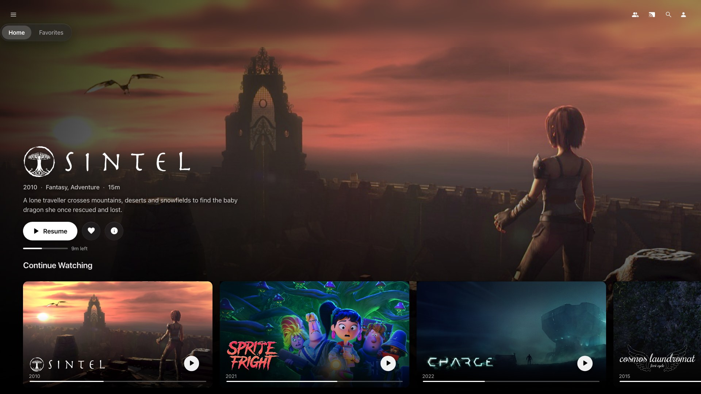
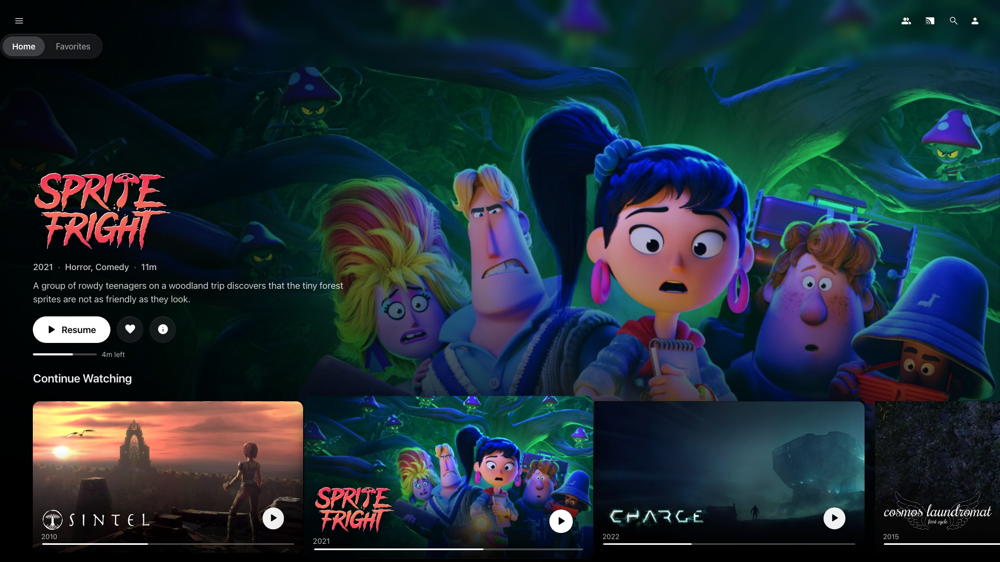
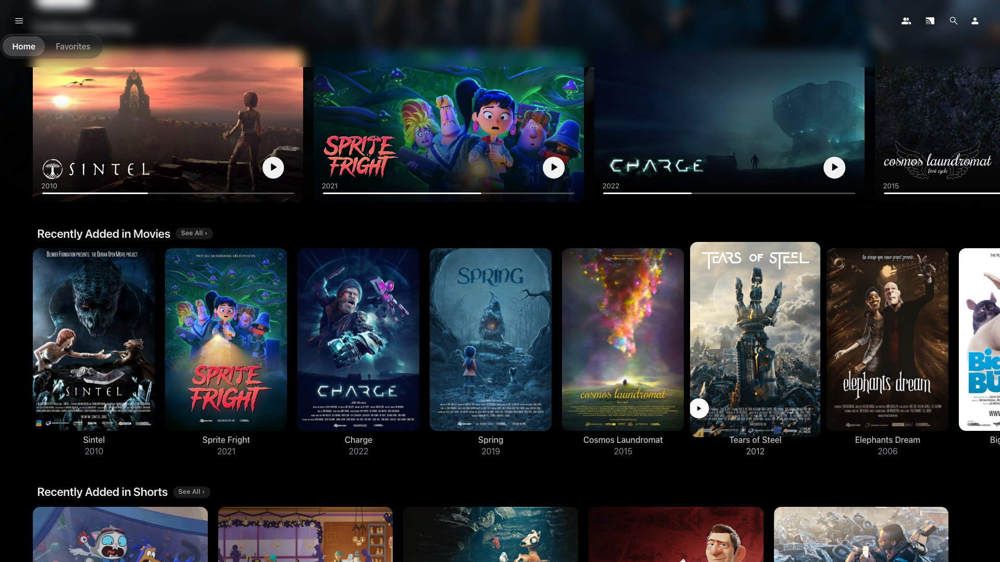
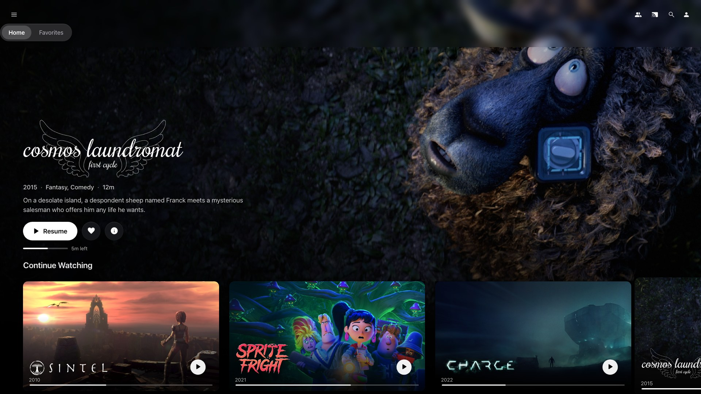
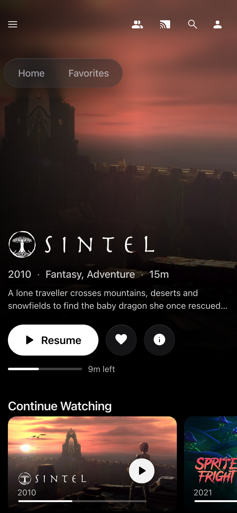

# Frostfin

Frostfin is a glass-inspired theme for the Jellyfin web client. It adds a featured hero
over full-bleed artwork, big Continue Watching tiles with title logos, a
floating glass tab bar, and posters that lift toward you when focused.

[](https://github.com/ashdriod/frostfin/actions/workflows/ci.yml)
[](https://github.com/ashdriod/frostfin/releases/latest)
[](#where-it-works)
[](LICENSE)



<table>
  <tr>
    <td></td>
    <td></td>
  </tr>
  <tr>
    <td></td>
    <td align="center"></td>
  </tr>
</table>

<sub>Screenshots show the built-in demo with the Blender Foundation's open movies. Artwork © Blender Foundation / Blender Studio, CC BY ([sources](demo/media/SOURCES.md)).</sub>

## Features

- **Featured hero** (with `theme.js`): title logo, year · genres · runtime,
  summary, and Resume / ♥ / ⓘ buttons over full-bleed artwork. It follows the
  card you hover or focus.
- **Continue Watching** as large tiles: the title logo on the art, a soft black
  gradient, an always-visible play button, and artwork loaded at the size it's shown.
- **"See All"** on rows like *Recently Added in Movies* opens the whole library
  instead of the Suggestions tab (with `theme.js`).
- No "My Media" row on Home. It can be brought back, see [Options](#options).
- A glass tab bar, a floating sidebar, and glass menus, dialogs and player controls.
- Posters lift on focus, Play buttons are white capsules, and focus works with a TV remote.
- Respects the Reduce Motion, Reduce Transparency and Increase Contrast settings.

## Install

The theme has two parts:

| File | What it does | Needed? |
| --- | --- | --- |
| `theme.css` | All the styling | Yes |
| `theme.js` | Hero, ambient artwork, sharp tiles with logos, "See All" fix | Recommended |

### 1. CSS

Back up whatever is in your Custom CSS box first.

In **Dashboard → General → Branding → Custom CSS code**, paste one of these,
then click **Save**:

```css
/* Pinned version (recommended): it changes only when you change the number */
@import url("https://cdn.jsdelivr.net/gh/ashdriod/frostfin@v1.0.0/dist/theme.min.css");
```

```css
/* Always the latest release (jsDelivr can take up to 12 hours to pick it up) */
@import url("https://cdn.jsdelivr.net/gh/ashdriod/frostfin@latest/dist/theme.min.css");
```

If you'd rather not use a CDN, paste the whole of `theme.css` from the
[latest release](https://github.com/ashdriod/frostfin/releases/latest) instead.

The theme then applies to every user and every web-based client on the server.

### 2. Companion script (recommended)

CSS can't change where a link goes or put artwork behind the page, so
`theme.js` adds those parts. It runs on the whole server through the
[JavaScript Injector](https://github.com/n00bcodr/Jellyfin-JavaScript-Injector) plugin:

1. Dashboard → Plugins → Repositories → add
   `https://raw.githubusercontent.com/n00bcodr/jellyfin-plugins/main/manifest.json`
2. Catalog → install **JavaScript Injector**, then restart Jellyfin.
3. Dashboard → JS Injector → add a script. Paste the contents of `theme.js`
   from the [latest release](https://github.com/ashdriod/frostfin/releases/latest),
   enable it, and save.
4. In each browser, reload once while bypassing the cache (**Ctrl/Cmd+Shift+R**).
   Until you do, the browser keeps showing its old cached page and the script doesn't run.

### Where it works

| Jellyfin | Status |
| --- | --- |
| **12.x** | Supported. Tested on 12.4.0 |
| 10.10 / 10.11 | Should work, since the web markup is the same, but untested |
| 10.9 | The general styling should work; the Home page changes are untested |
| 10.8 and older | Not supported |

It works in web-based clients: browsers, Jellyfin Media Player, the Android
and iOS apps, and webOS and Tizen TVs. Native apps that draw their own
interface ignore server CSS. That includes the Android TV / Fire TV app and Swiftfin.

The Home changes need a browser from 2022 or later: Chrome/Edge 105+,
Firefox 121+ or Safari 15.4+. On older TVs, Home falls back to the base styling.

### Uninstall

Remove the line or text from Custom CSS, and disable the script in JS Injector.

## Options

Add any of these after the `@import`, inside `:root { }`:

```css
:root {
  --frost-home-my-media: block;   /* bring back the "My Media" row */
  --frost-focus-scale: 1;         /* turn off the poster lift */
}
```

| Variable | Default | What it does |
| --- | --- | --- |
| `--frost-glass` | `1` | `0` makes every frosted surface solid. Useful on slow devices |
| `--frost-focus-scale` | `1.07` | How far a focused poster lifts. `1` turns lifting off |
| `--frost-radius-card` | `14px` | Poster corner radius |
| `--frost-home-my-media` | `none` | `block` brings back the "My Media" row on Home |
| `--frost-more-label` | `"More \203A"` | The label next to row titles. `theme.js` sets it to "See All ›" |
| `--libraryLabelVisibility` | `block` | `none` hides library names on Home tiles |

The [ElegantFin](https://github.com/lscambo13/ElegantFin) options listed at the
top of `src/css/00-elegantfin-base.css` still work.

## Troubleshooting

- **No hero, and "See All" still opens Suggestions:** the script isn't running.
  Reload with Ctrl/Cmd+Shift+R and check that the script is enabled in JS Injector.
- **The hero doesn't appear at all:** if you use the Editor's Choice plugin,
  the theme leaves the hero to that plugin and styles it instead.
- **Nothing changed after an update:** with the `@latest` URL, jsDelivr can take
  up to 12 hours to catch up. Pin a version to get changes immediately.

## Privacy and security

- `theme.css` loads the Inter and Material Symbols fonts from Google Fonts
  (`fonts.googleapis.com`, `fonts.gstatic.com`), as ElegantFin does. The
  jsDelivr `@import` also fetches the CSS from `cdn.jsdelivr.net`. To avoid
  both, paste the CSS instead and self-host the fonts.
- `theme.js` talks only to your own Jellyfin server, using the signed-in
  user's existing session. It sends nothing anywhere else and stores nothing.
  Text from the server is always inserted as plain text, never as HTML. The CI
  smoke test checks both on every change.
- GitHub Actions builds each release from the tagged source. Every release
  includes `SHA256SUMS.txt` and a build-provenance attestation you can verify:
  `gh attestation verify theme.css --repo ashdriod/frostfin`.

Please report vulnerabilities privately, as described in [SECURITY.md](SECURITY.md).

## Development

```
src/css/00-elegantfin-base.css   ElegantFin base layer, kept verbatim. Don't edit
src/css/10-glass.css             The glass layer. Edit this
src/js/theme.js                  Companion script
dist/                            Built output, committed so jsDelivr can serve it
demo/                            Demo Home page with Blender's open movies
scripts/                         Build, demo server, smoke test, screenshots
```

You need Node 20 or newer.

```sh
npm ci
npm run build                   # src/ → dist/
npm run demo                    # http://127.0.0.1:8099/  (?tv, ?mobile)
npx playwright install chromium # once
npm test                        # browser smoke test
npm run screenshots             # regenerate docs/screenshots/
```

The demo copies Jellyfin's markup but isn't Jellyfin, so test changes on a
real server too. [CONTRIBUTING.md](CONTRIBUTING.md) explains how releases are made.

## Credits

- [ElegantFin](https://github.com/lscambo13/ElegantFin) by lscambo13: the base layer (GPL-2.0).
- [JellyfinGlassTheme](https://github.com/MadhavKrishanGoswami/JellyfinGlassTheme) by Madhav Krishan Goswami: structure and plugin styling (MIT).
- Demo artwork: the [Blender Foundation](https://studio.blender.org)'s open movies, CC BY.

This is an unofficial theme and is not affiliated with the Jellyfin project.

## License

[GPL-2.0-only](LICENSE), because the theme includes ElegantFin. Third-party notices are in [NOTICE.md](NOTICE.md).
